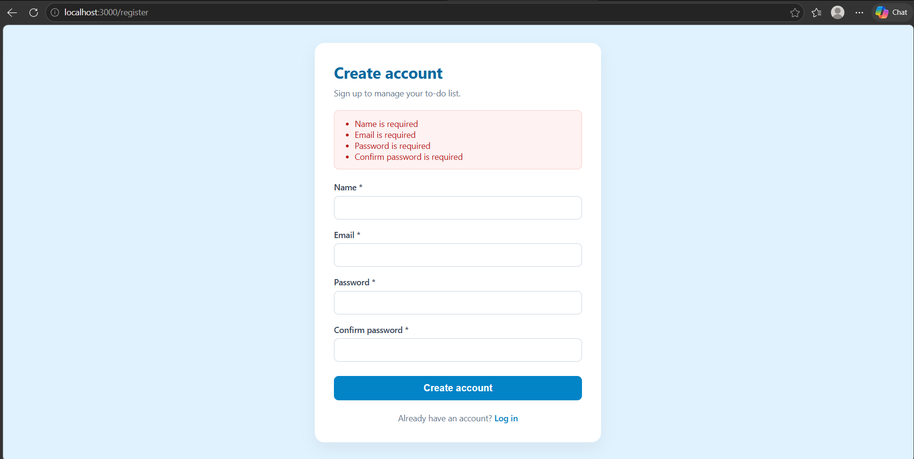
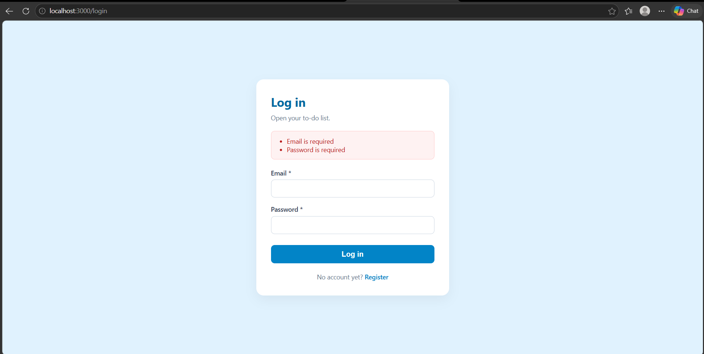
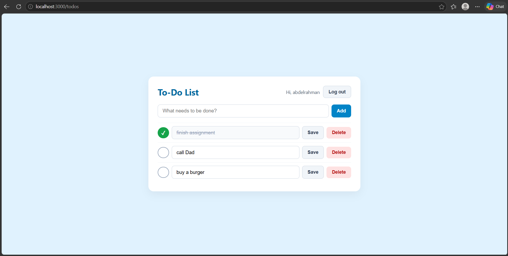
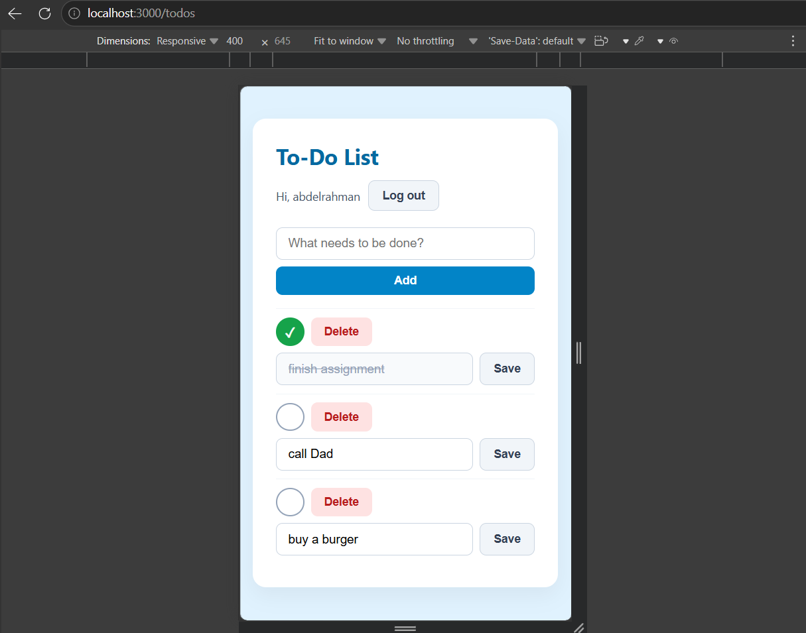

# Database Systems - Lab 2 (Login & To-Do Application)

## Team Information
- **Member 1:** Abdelrahman (GitHub: `abdelrahman2304221`)
- **Member 2:** Kareem
- **Repository:** https://github.com/abdelrahman2304221/db-lab2-AK

## Technologies Used
- **Back-end:** Node.js, Express.js, express-session, bcryptjs
- **Front-end:** HTML5, CSS3, EJS (Embedded JavaScript)
- **Database:** MySQL (using `mysql2/promise` pool)

## Screenshots
### 1. Register Page with Validation Errors


### 2. Login Page


### 3. To-Do List Page (with tasks)


### 4. Mobile View (Responsive Design)


## How to Run the Project (Step-by-Step)
1. Clone the repository:
   ```bash
   git clone [https://github.com/abdelrahman2304221/db-lab2-AK.git](https://github.com/abdelrahman2304221/db-lab2-AK.git)
   cd db-lab2-AK